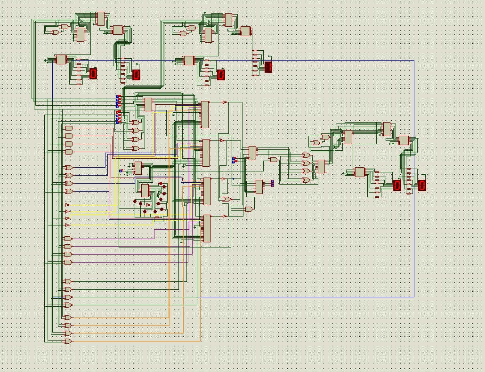

## 4-bit ALU

### Team members

- [Nakul G](https://www.linkedin.com/in/nakul-g-176b22387/)
- [Nandhu Ramesh](https://www.linkedin.com/in/nandhu-ramesh-419635351/)
- [S kailas](https://www.linkedin.com/in/s-kailas-575026366/)
- [Vyshakh Rajesh](https://www.linkedin.com/in/vyshakh-rajesh/)

We Designed and built a 4-bit ALU using discrete logic ICs.

**Circuit Designed and Simulated using:**
[Proteus](https://www.labcenter.com/)

**Find the Simulation File:** [Repos folder](https://github.com/VR00666/4-bit-ALU-Discrete-Logic-ICs/tree/main/proteus-simulation)

### Circuit Diagram

### List of componets used

