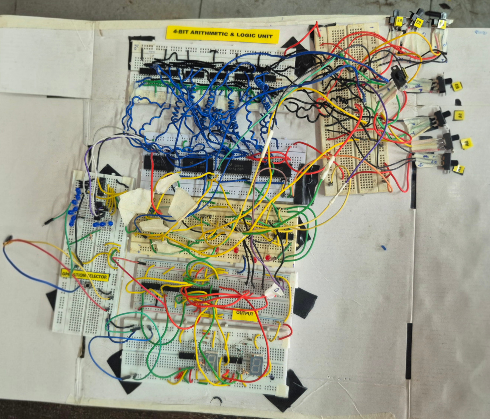

## 4-BIT Arithmetic Logic Unit

### Team members

- [Nakul G](https://www.linkedin.com/in/nakul-g-176b22387/)
- [Nandhu Ramesh](https://www.linkedin.com/in/nandhu-ramesh-419635351/)
- [S kailas](https://www.linkedin.com/in/s-kailas-575026366/)
- [Vyshakh Rajesh](https://www.linkedin.com/in/vyshakh-rajesh/)

We designed and built a 4-bit ALU using discrete logic ICs.

**Circuit Designed and Simulated using:**
[Proteus](https://www.labcenter.com/)

**Find the Simulation File:** [Repos folder](https://github.com/VR00666/4-bit-ALU-Discrete-Logic-ICs/tree/main/proteus-simulation)

### Circuit Diagram

### Hardware implementation

### List of componets used

| S.No. | Component                   | Specification |
| ----- | --------------------------- | ------------- |
| 1     | Quad 2-input XOR gate       | 74LS86        |
| 2     | Quad 2-input AND gate       | 74LS08        |
| 3     | Quad 2-input NAND gate      | 74LS00        |
| 4     | Quad 2-input NOR gate       | 74LS02        |
| 5     | Dual 4:1 multiplexer        | 74LS153       |
| 6     | Quad D flip-flop (register) | 74LS175       |
| 7     | Push button (LOAD)          | —             |
| 8     | Sliding switch (operands)   | —             |
| 9     | Breadboard                  | —             |
| 10    | Connecting wires            | —             |
| 11    | 5 V power supply            | —             |
| 12    | LED (result and flags)      | —             |

